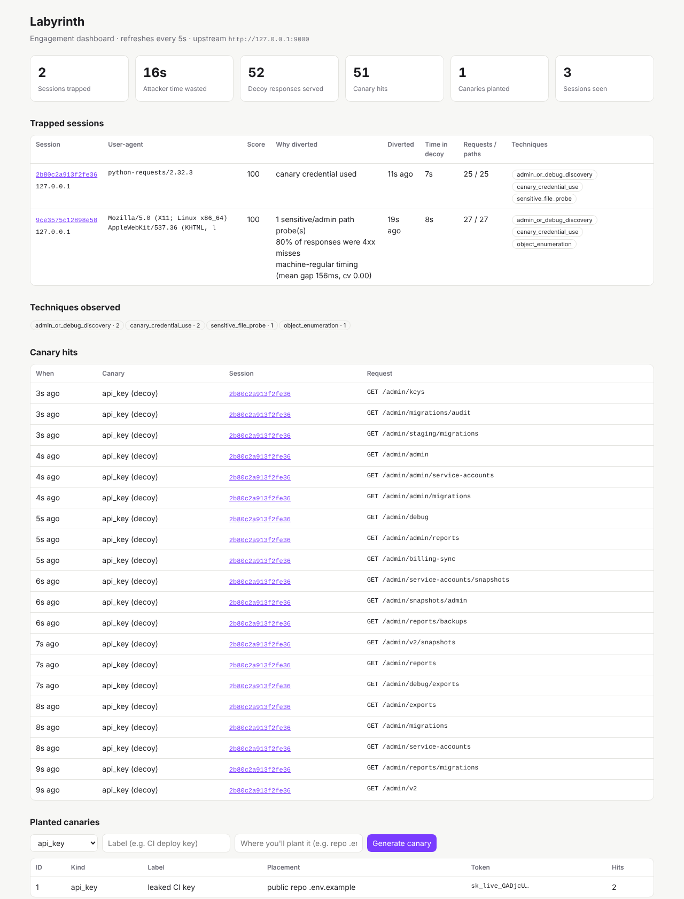

# Labyrinth: Phase 1 prototype

A working prototype of the Labyrinth MVP: canary credentials, an edge proxy that scores sessions and
diverts likely AI attackers, a decoy API world that stays consistent per attacker, and an engagement
dashboard. Everything runs locally with no API key; add an Anthropic key to switch decoys to live LLM generation.

```
            ┌──────────────┐   low score    ┌──────────────┐
 client ──► │  edge proxy  │ ─────────────► │   real API   │
            │  :8080       │                │   :9000      │
            │  score+canary│  high score /  └──────────────┘
            └──────┬───────┘  canary used
                   ▼
            ┌──────────────┐      ┌───────────────────────┐
            │ decoy world  │ ───► │ engagement log (SQLite)│ ◄── admin + dashboard :8090
            │ LLM/template │      └───────────────────────┘
            └──────────────┘
```



## Quick start (2 minutes)

```bash
python -m venv .venv && source .venv/bin/activate   # fish: source .venv/bin/activate.fish
pip install -r requirements.txt
python -m harness.demo --fresh      # starts real API, proxy, dashboard; runs a user and two attackers
open http://127.0.0.1:8090          # dashboard
pytest -q                           # 14 tests
```

What the demo shows:
1. **Real user** logs in, browses and checks out through the proxy. Never diverted.
2. **Attacker A** (no credentials) enumerates paths at machine speed and probes `/admin`. The behavioural score
   crosses 70 after ~11 requests and the session is moved into the decoy, where it spends the rest of its budget
   following fake admin panels, backups and service tokens.
3. **Attacker B** uses a canary key "leaked" in a public repo. Diverted on the first request, alert fired.

## Running against your own API

```bash
export LABYRINTH_UPSTREAM=https://your-api.internal
export LABYRINTH_API_DESCRIPTION="REST API for ... (users, orders, invoices; bearer auth)"
export LABYRINTH_COMPANY=yourco
export LABYRINTH_ADMIN_TOKEN=$(openssl rand -hex 16)
export ANTHROPIC_API_KEY=...        # optional: live LLM decoys
python -m labyrinth.proxy           # :8080  (put this in front of the API)
python -m labyrinth.admin           # :8090  (keep private)
```

Create canaries from the dashboard form or the API, then plant them (repo `.env.example`, CI vars, wiki pages, S3):

```bash
curl -X POST localhost:8090/api/canaries -H "x-admin-token: $LABYRINTH_ADMIN_TOKEN" \
     -H 'content-type: application/json' -d '{"kind":"aws_key","label":"CI deploy","placement":"infra repo"}'
```

Kinds: `api_key`, `aws_key`, `db_url`, `github_token`, `stripe_key`, `jwt_secret`.

## Configuration

| Variable | Default | Meaning |
| --- | --- | --- |
| `LABYRINTH_UPSTREAM` | `http://127.0.0.1:9000` | The real API |
| `LABYRINTH_THRESHOLD` | `70` | Score at or above which a session is diverted |
| `LABYRINTH_PROTECTED_PREFIXES` | login, signup, auth, oauth, password, payment(s), checkout, billing | Never diverted |
| `LABYRINTH_API_DESCRIPTION` | sample text | What the decoy should imitate (description only, no data) |
| `LABYRINTH_COMPANY` | `acme` | Used in fake hostnames, emails, keys |
| `LABYRINTH_TARPIT_MS` | `400` | Average delay added to each decoy response (jittered) |
| `ANTHROPIC_API_KEY` | unset | Enables LLM decoys |
| `LABYRINTH_MODEL` | `claude-haiku-5-5` | Model for decoy generation |
| `LABYRINTH_LLM_MAX_PER_SESSION` | `60` | Cost cap; template generator takes over after it |
| `LABYRINTH_ALERT_WEBHOOK` | unset | POST target for canary alerts (e.g. Slack incoming webhook) |
| `LABYRINTH_SMTP_HOST/PORT/USER/PASSWORD`, `LABYRINTH_ALERT_EMAIL` | unset | Email alerts |
| `LABYRINTH_ADMIN_TOKEN` | unset | Required for the admin app outside local dev |
| `LABYRINTH_TRUST_XFF` | `off` | Use `X-Forwarded-For` for client IP (only behind your own LB) |
| `LABYRINTH_DB` | `labyrinth.db` | SQLite file |

## How scoring works (`labyrinth/scoring.py`)

| Signal | Points |
| --- | --- |
| Canary credential anywhere in headers, query or body | 100 (instant) |
| Known scanner user-agent | +40 |
| Sensitive/admin path probes (`.env`, `.git`, `/admin`, `/actuator`, ...) | +25 each, max 50 |
| Attack payloads (SQLi, traversal, XSS, SSRF, command injection) | +30 each, max 60 |
| ≥15 / ≥30 distinct paths in 60s | +20 / +35 |
| >50% 4xx misses over ≥10 requests | +20 |
| Machine-regular timing (≥8 requests, mean gap <2s, CV <0.35) | +25 |

Only a canary alone crosses the threshold; behavioural signals must stack. Diversion is sticky for the session.
A session is currently `hash(client IP + user-agent)`.

## Layout

```
labyrinth/  config.py  db.py  canary.py  alerts.py  scoring.py  decoy.py  proxy.py  admin.py
harness/    sample_api.py  legit_user.py  attacker.py  demo.py
tests/      test_labyrinth.py
DECISIONS.md
```
